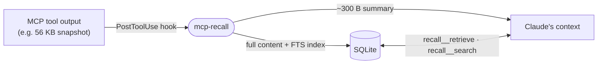

# mcp-recall

[](https://github.com/sakebomb/mcp-recall/actions/workflows/ci.yml)
[](https://www.npmjs.com/package/mcp-recall)
[](https://www.npmjs.com/package/mcp-recall)


[](CONTRIBUTING.md)


**Your context window is finite. Tool outputs aren't. mcp-recall bridges the gap.**

MCP tool outputs (Playwright snapshots, GitHub API responses, Linear queries) and long Bash output can consume tens of kilobytes of context per call, and a busy session fills even a large context window long before the work is done. mcp-recall intercepts those outputs, stores them in full locally, and delivers compressed summaries to Claude instead. When Claude needs more detail, it can search the stored output and retrieve it, without re-running the tool.

The goal is sessions that run for hours instead of hitting the context limit in minutes. [Results](#results) shows what is measured today, and the [quality benchmark](docs/benchmarks.md) what the summaries keep.


---

## Quick start

You need [Claude Code](https://claude.ai/claude-code) and [Bun](https://bun.sh) (`curl -fsSL https://bun.sh/install | bash`). To run without Bun, use the [standalone binary](docs/install.md#option-d--standalone-binary-no-bun).

```bash
bun add -g mcp-recall    # or: npm i -g mcp-recall
mcp-recall install       # register the hooks and MCP server in Claude Code
mcp-recall profiles seed # optional: compression profiles for the MCPs you use
```

Restart Claude Code, then run `mcp-recall status`: every check should be green. That's it. Claude now receives summaries, and uses the `recall__*` tools when it needs the full output.

`mcp-recall install` writes the MCP server entry and hooks to `~/.claude.json` and `~/.claude/settings.json`, and adds a short instruction block to `~/.claude/CLAUDE.md`. It is idempotent, so re-run it after every update.

→ [Quickstart](docs/quickstart.md) · [All install options, updating and uninstalling](docs/install.md) (plugin marketplace, from source, standalone binary)

---

## How it works



The [architecture guide](docs/architecture.md#the-capture-pipeline) walks through the full pipeline step by step.

**Two hooks, one MCP server.**

- `SessionStart` hook: injects a short snapshot of pinned items, notes and recent activity before the first message, records the active day, and prunes expired items.
- `PostToolUse` hook: replaces large MCP and Bash output with a summary and stores the full output. A Bash read of 8 KB or less (`cat`, `git diff`, `| head -40`, `sed -n 900,1000p`) is delivered whole, and identical output from the same tool and command returns a cached header.
- `recall` MCP server: eleven `recall__*` tools Claude uses to search and retrieve what was stored.

**What it covers.** MCP tools (`mcp__*`, except mcp-recall's own) and the native Bash tool. Each output is routed to a handler built for its shape, so `git diff`, test runners, compilers and `grep` get summaries that put failures and errors first. The [handler reference](docs/handlers.md) lists every handler and what it keeps. The built-in Read, Grep and Glob pass through unchanged; if large file reads are your biggest cost, the [filesystem MCP server](https://github.com/modelcontextprotocol/servers) can be intercepted where Read can't.

---

## Using it

Each compressed output starts with a header line that names the stored item, its sizes, and a few `search:` hints, which are salient terms from the full content so Claude's first `recall__search` lands without guessing keywords:

```
[recall:recall_abc12345 · 56.2KB→299B (99% reduction) · search: "checkout", "sessionToken", "orderId"]
```

Repeated identical tool calls return a cached header instead of re-compressing:

```
[recall:recall_abc12345 · cached · 2026-03-01]
```

Eleven `recall__*` tools are available to Claude in every session. You don't call them yourself; Claude uses them when it needs detail.

| Tool | Use when |
|---|---|
| `recall__context` | Start of session — get pinned items, notes, and recent activity |
| `recall__retrieve(id, query?, mode?)` | Need detail from a prior tool call — `summary` / `peek` / `full` tiers |
| `recall__search(query, tool?)` | Find stored output by content, no ID needed |
| `recall__pin(id)` | Protect an item from expiry and eviction |
| `recall__note(text, title?)` | Store a conclusion or decision as project memory |
| `recall__stats()` | Session efficiency report with savings and suggestions |
| `recall__session_summary(date?)` | Digest of a specific session's activity |
| `recall__list_stored(sort?, tool?)` | Browse stored items |
| `recall__forget(...)` | Delete by id, tool, session, age, or all |
| `recall__export()` | JSON dump of all stored items |
| `recall__suggest()` | Surface pin candidates and stale items, with the command to act on each |

→ [Full tool reference](docs/tools.md)

---

## Results

- **How much smaller.** On one developer's real store (36,039 calls, July to October 2026), MCP output replayed through today's handlers came out 96.6% smaller, and all intercepted calls 57.9% smaller as recorded. One person's mix, dominated by Bash; yours will differ. Run `bun run measure` on your own store.
- **What the summaries keep.** The [quality benchmark](docs/benchmarks.md#quality-benchmark) scores the facts each summary keeps against a same-size head cut, on a public corpus anyone can rerun with `bun run quality`. It names every family where mcp-recall does no better than the head cut.
- **Whether the agent still solves the task.** A paired benchmark of the same agent with and without mcp-recall is in progress ([#414](https://github.com/sakebomb/mcp-recall/issues/414)).

Long, structured, repetitive output (Playwright snapshots, API JSON, large diffs, test logs) compresses well; short or one-off output has little to remove. Every figure, its method and its caveats: [Benchmarks](docs/benchmarks.md).

---

## Profiles

Profiles teach mcp-recall how to compress output from specific MCPs, as declarative TOML with no TypeScript required. Five profiles ship built in (Jira, Gmail, Context7, Docker, Cloudflare docs), and **[26 community profiles](https://github.com/sakebomb/mcp-recall-profiles)** cover Stripe, Grafana, Shopify, Datadog, Notion, Teams, and more.

```bash
mcp-recall profiles seed        # install community profiles for your connected MCPs
mcp-recall profiles available   # browse the catalog
mcp-recall profiles update      # keep installed profiles up to date
mcp-recall learn                # generate profiles from your installed MCPs
```

→ [Profiles quickstart](docs/profiles-quickstart.md) · [Profile schema](docs/profile-schema.md) · [retrain guide](docs/retrain.md) · [AI profile guide](docs/ai-profile-guide.md) · [Contributing a profile](CONTRIBUTING.md#contributing-a-profile)

---

## Configuration

mcp-recall works out of the box. To customize it, create `~/.config/mcp-recall/config.toml`. The settings most people change:

| Setting | Default | What it does |
|---|---|---|
| `store.expire_after_session_days` | `30` | Days you **actively use** Claude Code on a project before stored items expire. Calendar time away doesn't count |
| `store.max_size_mb` | `500` | Target store size; past it, unpinned items are evicted lowest-value first |
| `store.retention` | `"balanced"` | Which outputs keep a retrievable full body: `full`, `balanced` (reproducible Bash is stored summary-only), or `minimal` |
| `denylist.additional` / `denylist.allowlist` | empty | Extra tool patterns never to store, or tools to store despite a deny pattern |
| `debug.enabled` | `false` | Diagnostic logging to stderr (same as `RECALL_DEBUG=1`) |

→ [Full configuration reference](docs/configuration.md): every key with its trade-offs, environment variables, and how session days work.

---

## Maintenance and CLI

```bash
mcp-recall install              # register hooks + MCP server in Claude Code
mcp-recall uninstall            # remove hooks + MCP server
mcp-recall status               # report install health and store size
mcp-recall serve                # run the MCP server on stdio (Claude Code starts it)
mcp-recall gc [--force]         # reclaim disk (dry run unless --force)
mcp-recall discover [--all]     # rank output routed to fallback handlers (--since, --limit)
mcp-recall learn                # generate profiles from your installed MCPs
mcp-recall profiles <cmd>       # manage compression profiles (see Profiles above)
mcp-recall import <file>        # restore items from a recall__export dump
mcp-recall completions <shell>  # print a bash / zsh / fish completion script
```

`mcp-recall --help` lists every subcommand. Update with `bun update -g mcp-recall && mcp-recall install`.

Each project gets its own SQLite database under `~/.local/share/mcp-recall/`. `mcp-recall gc` is a dry run by default and never deletes a database whose project might still exist. Shell completions: `mcp-recall completions zsh > ~/.zfunc/_mcp-recall`.

→ [Maintenance details](docs/maintenance.md): what `gc` deletes and why, `--vacuum`, and import options.

---

## Safety and privacy

- **Credentials are never stored.** Password-manager MCPs (1Password, Bitwarden, Vault and others) are blocked by name, credential-like tool names (`*secret*`, `*token*`, `*api_key*`, …) by pattern, and every output is scanned for secrets (PEM headers, GitHub PATs, AWS keys) before any write. A tool blocked by mistake goes in `denylist.allowlist`. Full lists: [SECURITY.md](SECURITY.md).
- **Everything stays on your machine**, in `~/.local/share/mcp-recall/`. Nothing is sent anywhere. The database holds full tool outputs, so treat it accordingly. `recall__forget(all: true, confirmed: true)` wipes the current project; deleting the directory wipes everything.
- **Running alongside rtk:** its command-rewriting hook was measured with mcp-recall, and the [install guide](docs/install.md#running-alongside-rtk) says what changes. Its PostToolUse pipeline is untested.

### Error contract

mcp-recall never breaks a tool call. Every failure mode — hook crash, SQLite error, handler exception, timeout, secret detected — degrades gracefully to the original uncompressed output passing through unchanged. The session gets slightly worse context efficiency. It never gets broken.

---

## How it compares

Context pressure builds at four distinct layers. Native Claude tooling covers the first two well. For **MCP** tool output it keeps everything, but either puts all of it in the window or hands Claude a file to read. That's the gap mcp-recall fills.

| Layer | Problem | Solution |
|---|---|---|
| **① Tool definitions** | Every connected MCP loads its full schema upfront (~500 tokens/tool) | [Claude Code Tool Search](https://code.claude.com/docs/en/mcp#scale-with-mcp-tool-search) (built-in) · Switchboard |
| **② Intermediate results** | Multi-step workflows pass each result back through context | [Code Mode](https://blog.cloudflare.com/code-mode/) · [FastMCP 3.1](https://www.jlowin.dev/blog/fastmcp-3-1-code-mode) |
| **③ MCP tool outputs** | Up to 25k tokens or 50k characters, an MCP result enters the window whole. Above that, Claude Code saves it to a file and Claude must read the file in chunks. Neither is searchable later | **mcp-recall** |
| **④ Cross-session memory** | Context vanishes when the session ends; the API memory tool is a model-managed summary, not a searchable verbatim archive | **mcp-recall** |

For layer ③, [Claude Code](https://code.claude.com/docs/en/mcp) puts an MCP result under `MAX_MCP_OUTPUT_TOKENS` (25,000 by default) into the window whole, and saves a larger one under the session's `tool-results` directory with a notice to read it in chunks. mcp-recall replaces a result with a summary before it reaches the window and keeps the full output searchable; for a result Claude Code already saved to a file, it stores and summarizes the file's content rather than the notice.

API [context editing](https://platform.claude.com/docs/en/build-with-claude/context-editing), [compaction](https://platform.claude.com/docs/en/build-with-claude/compaction) and the [memory tool](https://platform.claude.com/docs/en/agents-and-tools/tool-use/memory-tool) also reduce context, through eviction or model-written summaries, with no verbatim retrieval of the original output. They stack with mcp-recall, which sits ahead of them as the tool-output layer.

---

## Learn more

- **Something not working:** [Troubleshooting guide](docs/troubleshooting.md).
- **Contributing:** the easiest contribution is a TOML profile, with no TypeScript and no clone of this repo. Check the [community profiles repo](https://github.com/sakebomb/mcp-recall-profiles) or open a [profile request](https://github.com/sakebomb/mcp-recall/issues/new?template=profile-request.md). TypeScript handlers are welcome for complex non-JSON output (HTML, DOM trees, binary formats): [CONTRIBUTING.md](CONTRIBUTING.md) has the workflow (`bun install && bun test`) and how to add one, and [docs/architecture.md](docs/architecture.md) the pipeline and the invariants a change must not break.
- **Where it's headed**, and what it deliberately won't become: [ROADMAP.md](ROADMAP.md).
- **Release history:** [CHANGELOG.md](CHANGELOG.md).
- **License:** Apache-2.0, see [LICENSE](LICENSE) and [NOTICE](NOTICE). Releases up to 1.19.0 were published under MIT and stay under it.
